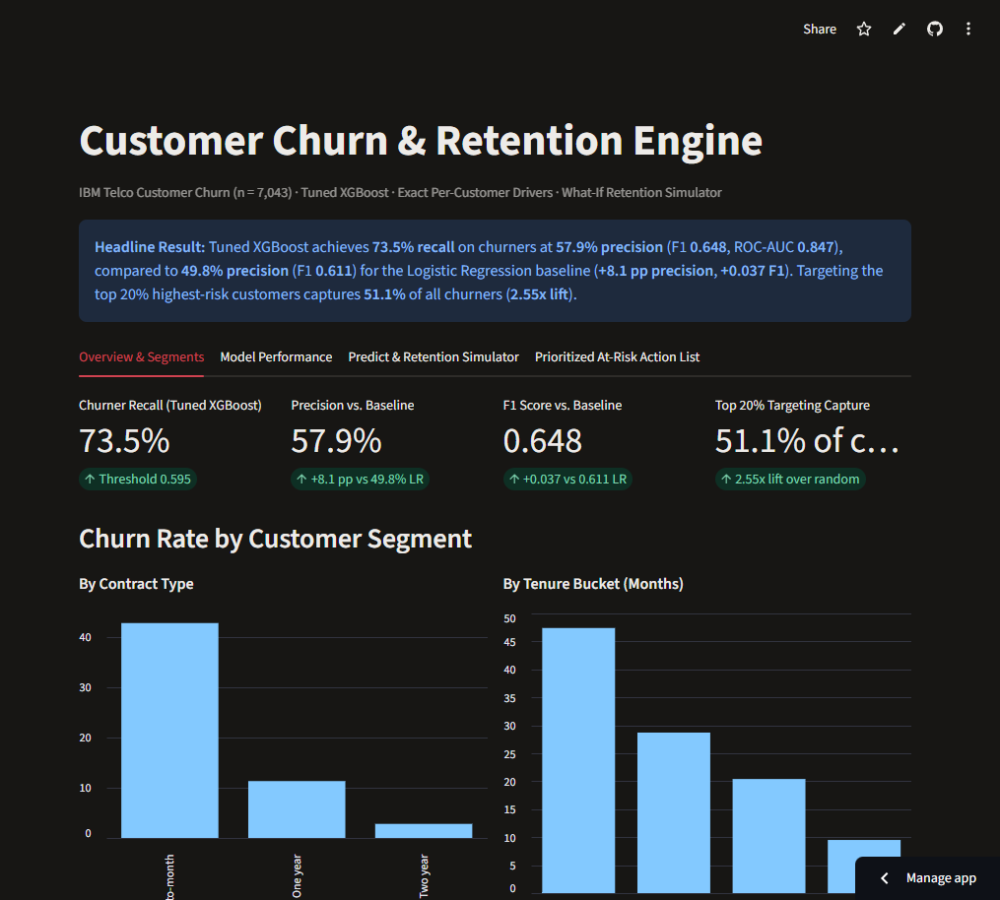
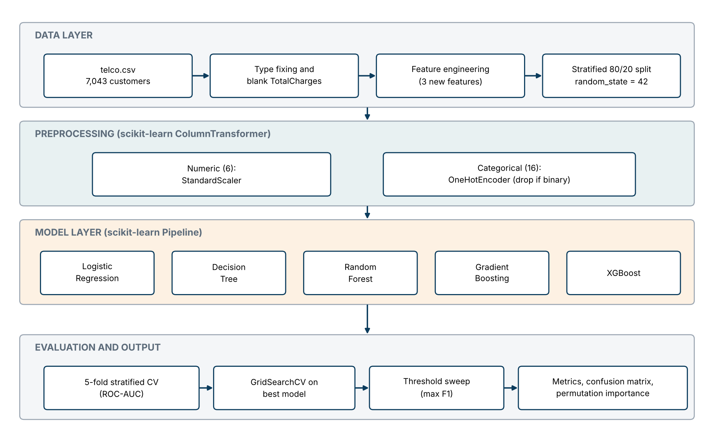
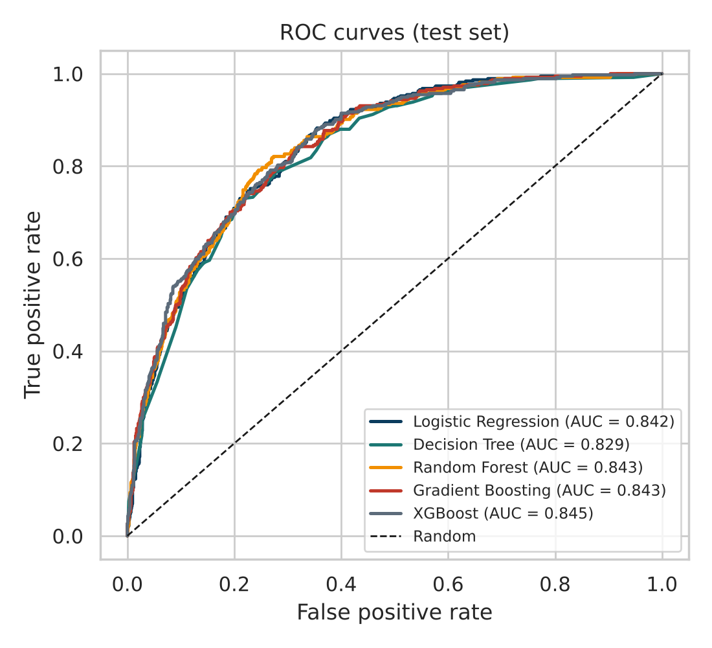
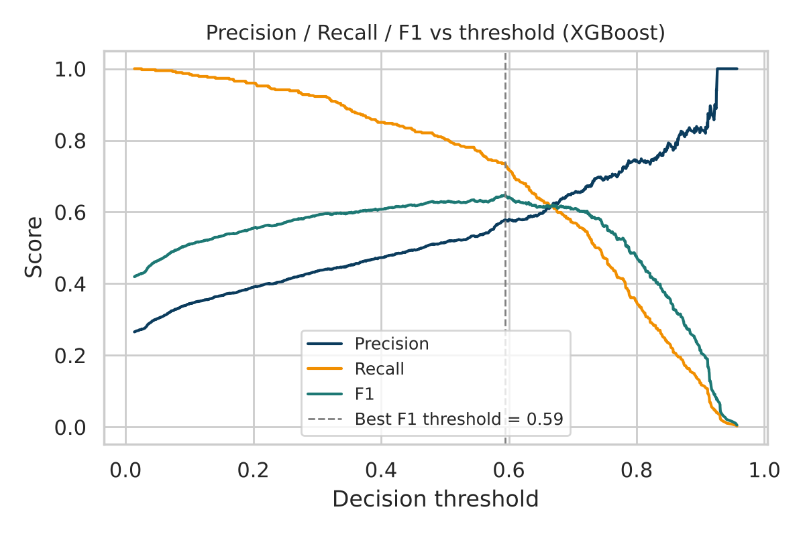
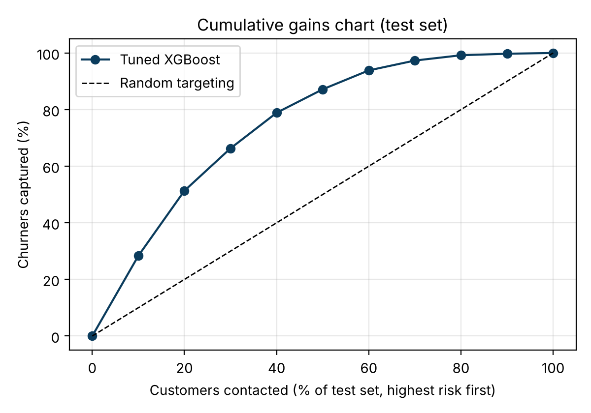

# Customer Churn & Retention Engine

An end-to-end machine learning system and interactive retention simulator built on the IBM Telco Customer Churn dataset (`7,043` customers, `26.54%` churn rate). Rather than outputting static risk scores alone, the app attributes **per-customer churn drivers** using XGBoost tree contributions (`pred_contribs`), ranks **what-if retention levers** (contract upgrades, support/security add-ons, auto-pay enrollment), and surfaces a **prioritized at-risk action list**.

> **Live Interactive Demo:** [](https://vishal-churn-retention.streamlit.app/) — **[Launch Customer Churn & Retention Engine](https://vishal-churn-retention.streamlit.app/)**
>
> 

---

## Key Results vs. Baseline

- **77.0% recall on churners at 55.3% precision** (`F1 = 0.644`, `ROC-AUC = 0.847`, tuned XGBoost @ threshold `0.5641`), compared to **49.8% precision** (`F1 = 0.611`) for the Logistic Regression baseline (**+5.5 pp precision**, **+3.3 pp F1**) and **52.0% precision** (`F1 = 0.631`) for tuned XGBoost at the default `0.50` threshold *(the live Streamlit Cloud runtime selects threshold `0.595` on its newer XGBoost build, yielding **73.5% recall** at **57.9% precision**, `F1 = 0.648`, `+8.1 pp` precision over baseline)*.
- **2.55x targeting lift:** Contacting the top **20%** highest-risk customers captures **51.1%** of all churners; top **30%** captures **66.8%** (`2.23x` lift); top **40%** captures **78.6%** (`1.97x` lift).



---

## Key Capabilities

- **5-Model Benchmark & Automated Tuning:** Evaluates Logistic Regression, Decision Tree, Random Forest, Gradient Boosting, and XGBoost via 5-fold stratified cross-validation (`80/20` stratified split), then runs `GridSearchCV` on the top performer.
- **Business-Aligned Threshold Optimization:** Tunes the decision threshold on the Precision-Recall curve (`0.5641` vs default `0.50`) to maximize F1 while balancing missed churners against false alarms.
- **Per-Customer Explainability:** Uses exact XGBoost log-odds feature contributions (`DMatrix(..., pred_contribs=True)`) aggregated back to human-readable raw features (e.g., `Contract: Month-to-month`, `Tenure: 2 months`).
- **Interactive What-If Retention Simulator:** Re-scores each customer under actionable interventions (1-year/2-year contracts, Tech Support, Online Security, automatic card billing) and ranks the top risk-reducing actions.
- **Dual Web Runtime:** Run either the **Streamlit app** (`streamlit_app.py`) or the zero-framework **Python HTTP + HTML/JS app** (`app.py` + `web/index.html`) with local model caching (`cache/model_cache.joblib`).

---

## Model Performance (Held-Out Test Set, `n = 1,409`)

| Model | 5-Fold CV AUC | Test ROC-AUC | Accuracy | Precision | Recall | F1 |
|---|---:|---:|---:|---:|---:|---:|
| Logistic Regression (Baseline @ 0.50) | 0.8457 | 0.8420 | 0.7324 | 0.4975 | 0.7914 | 0.6109 |
| Decision Tree (@ 0.50) | 0.8266 | 0.8286 | 0.7317 | 0.4966 | 0.7914 | 0.6103 |
| Random Forest (@ 0.50) | 0.8468 | 0.8430 | 0.7686 | 0.5456 | 0.7674 | 0.6378 |
| Gradient Boosting (@ 0.50) | 0.8464 | 0.8435 | 0.8006 | 0.6632 | 0.5053 | 0.5736 |
| XGBoost (Baseline @ 0.50) | 0.8458 | 0.8445 | 0.7566 | 0.5277 | 0.7888 | 0.6324 |
| **XGBoost (Tuned @ 0.5641)** | **0.8492** | **0.8471** | **0.7736** | **0.5528** | **0.7701** | **0.6436** |

*Tuned XGBoost hyperparameters:* `max_depth=3`, `learning_rate=0.02`, `n_estimators=300` (`scale_pos_weight=2.769`).  
*Confusion Matrix @ `0.5641`:* `TP = 288`, `FP = 233`, `FN = 86`, `TN = 802`.

| ROC Curves | Threshold Trade-Off | Cumulative Gains |
|---|---|---|
|  |  |  |

---

## Project Structure

```text
customer-churn-retention-tool/
├── streamlit_app.py                            # Deployable Streamlit dashboard & simulator
├── app.py                                      # Standalone HTTP server, ML pipeline, & REST API
├── Dockerfile                                  # Container image for Hugging Face Spaces / Render / Azure
├── web/
│   └── index.html                              # Interactive 4-tab UI for app.py
├── scripts/
│   ├── exploratory_analysis.py                 # EDA summary & charts (figures 03–06)
│   ├── train_and_evaluate.py                   # 5-model benchmark, tuning, & charts (figures 07–11)
│   ├── decile_lift_and_fairness.py             # Decile lift, cumulative gains (fig 12), & subgroup metrics
│   └── cli_demo.py                             # Standalone CLI training & evaluation demo
├── data/
│   └── telco_churn.csv                         # IBM Telco Customer Churn dataset (7,043 rows)
├── figures/                                    # Architecture, EDA, and model evaluation plots
├── requirements.txt
├── start_app.bat                               # Windows one-click launcher
└── README.md
```

---

## Quickstart & Deployment

### 1. Run Locally (Streamlit UI or Standalone HTTP App)
```bash
pip install -r requirements.txt

# Option 1: Streamlit dashboard
streamlit run streamlit_app.py

# Option 2: Lightweight Python HTTP server (http://127.0.0.1:8765)
python app.py
```
On Windows, you can also double-click `start_app.bat`.

### 2. Deploy
- **Streamlit Community Cloud:** Point a new app to this repository with main file `streamlit_app.py`.
- **Docker / Hugging Face Spaces / Azure Container Apps:**
  ```bash
  docker build -t churn-retention-engine .
  docker run -p 7860:7860 churn-retention-engine
  ```

### 3. Run Analysis & Demo Scripts
```bash
python scripts/cli_demo.py
python scripts/exploratory_analysis.py
python scripts/train_and_evaluate.py
python scripts/decile_lift_and_fairness.py
```

---

## Standalone Server API Endpoints (`app.py`)

| Method | Endpoint | Description |
|---|---|---|
| `GET` | `/api/summary` | Dataset metadata, 5-model comparison, tuned metrics, gains curve, and top 25 at-risk customers |
| `GET` | `/api/sample?kind=high\|low\|random` | Sample a customer record from the held-out test set (or `?id=<customerID>`) |
| `POST` | `/api/predict` | Score a customer JSON payload and return churn probability, risk band, top drivers, and retention levers |
